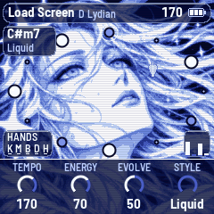
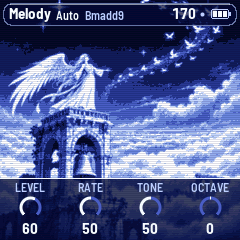
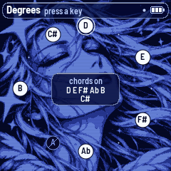

# AQ-1 for the M-VAVE FM-1

AQ-1 turns the M-VAVE FM-1 into a generative light drum & bass instrument, in the mood of console menus and
loading screens from the 2000s: warm, calm and hopeful, as if something is about to begin. It composes chords,
rhythms and melodies without end, and you decide what plays. It powers on with only the keys and the pad; you
bring in the melody, the bass, the drums and the hats by hand, shape them with the knobs and call breaks. If
you'd rather have the piece play itself, switch it to Auto.

  

- **Read the manual:** [docs/MANUAL.md](docs/MANUAL.md)
- **Build it from source:** [BUILDING.md](BUILDING.md)

## Install

There's no published AQ-1 release yet, so you need a package file, `aq1.fwsc`. Build it as described in
[BUILDING.md](BUILDING.md) (`app/build/aq1.fwsc`), or use a file you got from someone who did.

Installing other firmware is at your own risk. Before you start, read how to get back, below.

1. Install Python 3, then `pip3 install mido python-rtmidi`.
2. Connect the FM-1 with a USB data cable and switch it on.
3. Run this from the source tree:

   ```
   python3 base/tools/fm1_install.py app/build/aq1.fwsc
   ```

4. Don't unplug it while it writes. When it finishes, the FM-1 restarts into AQ-1.

An FM-1 running M-VAVE's "Open" firmware must go back to the stock firmware first; the installer tells you so.

## Back to the stock firmware

Download M-VAVE's FM-1 firmware
([FM-1.fwsc](https://yms-file-store.oss-cn-hongkong.aliyuncs.com/software/firmware/FM-1.fwsc)) and install it
the same way:

```
python3 base/tools/fm1_install.py FM-1.fwsc
```

M-VAVE's own updater, M-UPGRADE, can also do it. What AQ-1 saved may be lost.

An FM-1 that fails to start twice comes up in a safe mode with USB working, so the same command can reach it.
If it no longer starts at all, see "Recovering an FM-1 that won't start" in the [manual](docs/MANUAL.md).

## In short

| | |
|---|---|
| Keys | The scale: each key adds its note or takes it out |
| SELECT + a key | Whether chords may stand on that note |
| SELECT + ENV · ARP · LFO · SEQ · FX | Keys and pad · melody · bass · kick and snare · hats, on or off |
| SELECT + HOME | Hands (you lead) or Auto (the arranger leads) |
| SELECT + KNOB 1 | On Keys, Melody and Bass: the layer's sound (on Keys, KNOB 2: the pad's) |
| PLAY · REC | Play / rest · hold the chord |
| EDIT · SELECT + EDIT | The next section · a break, each on the next bar |
| HOME · ENV · ARP · LFO · SEQ · FX · GLO | The pages: Home, Keys, Melody, Bass, Drums, Space, Setup; KNOB 1–4 set their values |
| SELECT | Turn: the previous or next page; with HOME held, the tempo. Hold it alone: the Degrees screen |
| ALGORITHM · PRESETS | The mode · the piece (eight of them) |
| OCT− / OCT+ | The melody's octave |
| SAVE | Saves; held for 1.5 s, puts the piece back to its recipe |

Hold a button for a second and a card says what it does (not PLAY or SELECT).

## Credits

AQ-1 is a fork of [AMB-1](https://github.com/charlesvestal/fm1-amb) by Charles Vestal, and keeps its form (it
plays by itself, with the scale on the keys), its echoes and its reverb. The reverb is Jon Dattorro's plate
("Effect Design, Part 1", JAES 1997), by way of [FoMni-1](https://github.com/charlesvestal/fm1-fomni). AQ-1 is built
on [fm1-base](https://github.com/charlesvestal/fm1-base) and [felucca-bsp](https://github.com/hugelton/felucca-bsp),
from [Felucca](https://github.com/hugelton/Felucca) by Leo Kuroshita (Hügelton Instruments).

The code is under MPL-2.0. The licence of the screen's art has not been decided and the MPL doesn't cover it; see
[LICENSING.md](LICENSING.md).

M-VAVE and FM-1 are trademarks of their owners. AQ-1 isn't affiliated with M-VAVE, Charles Vestal or Hügelton
Instruments.
