# AQ-1

AQ-1 turns the M-VAVE FM-1 into a generative light drum & bass instrument, in the mood of console menus and loading
screens from the 2000s: warm, calm and hopeful, as if something is about to begin. It composes chords, rhythms and
melodies without end. You don't play the notes; you decide what plays, and when.

, running AQ-1, each control labelled")

---

## Contents

1. Install
2. Getting started
3. Controls
4. Building a piece
5. Auto
6. The pieces
7. The pages
8. The screens
9. The system's notes
10. MIDI
11. Saving
12. Troubleshooting
13. Parameters
14. Credits

---

## 1. Install

There's no published AQ-1 release yet, so you need a package file, `aq1.fwsc`. Build it from the source
(`BUILDING.md`), or use a file you got from someone who did.

Install Python 3 and `pip3 install mido python-rtmidi`, connect the FM-1 with a USB data cable, and run this from the
source tree:

```
python3 base/tools/fm1_install.py aq1.fwsc
```

Don't unplug it while it's writing. When it finishes, the FM-1 restarts into AQ-1. An FM-1 on M-VAVE's "Open" firmware
must go back to the stock firmware first.

**Go back:** download M-VAVE's firmware
([FM-1.fwsc](https://yms-file-store.oss-cn-hongkong.aliyuncs.com/software/firmware/FM-1.fwsc)) and install it with the
same command. M-VAVE's own updater, M-UPGRADE, can also do it. What AQ-1 saved may be lost.

> Installing other firmware is at your own risk. If the FM-1 ever won't start, see
> "Recovering an FM-1 that won't start", under Troubleshooting.

---

## 2. Getting started

AQ-1 starts playing as soon as it's on, with five rising notes and then only the keys and the pad. A few minutes
with it:

1. **Listen.** The first piece, Load Screen, is playing in D Lydian. Turn MASTER for the volume.
2. **Bring in the melody.** Hold SELECT and press ARP. A phrase comes within a few bars.
3. **Bring in the bass and the drums.** Hold SELECT and press LFO, then SEQ, then FX. The bass, the kick and snare,
   and the hats each come in on the next bar line.
4. **Set how much the drums play.** Press HOME and turn KNOB 2, Energy: half time at the bottom, a full beat at the top.
5. **Call a break.** Hold SELECT and press EDIT. The break starts on the next bar.
6. **Change the scale.** Press a key whose note is lit: it leaves the scale. Press it again to bring it back. Any key
   that isn't lit adds its note.
7. **Try another piece.** Turn PRESETS. The layers you have on stay on.
8. **Rest.** Press PLAY: the drums, the bass and the melody stop, and the keys and the pad stay on the chord. PLAY again
   carries on from exactly there.

What you change is kept with the piece. AQ-1 saves it by itself while resting, or press SAVE.

Not sure what a button does? Hold it for a second and a card says. Let go and nothing else happens.

---

## 3. Controls

The drawing at the top shows most of them; here they all are.

| Control | What it does |
|---|---|
| Keys | The scale. Each key adds its note to the scale or takes it out, and the keys light up for the notes in it. Every octave of a note is the same key. The root stays, and the scale keeps at least three notes. |
| SELECT + a key | Whether chords may stand on that note (see "Degrees"). |
| PLAY | Play / rest. Lit green while playing. It acts at once, even during a save. |
| REC | **Hold**: no new chord and no new section, while everything else plays on over the chord. Press again to let go. Lit while held. |
| EDIT | The next section, on the next bar. While resting, on the first bar after it plays again. |
| SELECT + EDIT | A break on the next bar, if it's playing and there are drums to play it. Otherwise the screen says `NO DRUMS` `NO BREAK`. |
| HOME | The Home page. |
| ENV · ARP · LFO · SEQ · FX · GLO | The Keys, Melody, Bass, Drums, Space and Setup pages. The lit button shows the page. |
| SELECT + ENV · ARP · LFO · SEQ · FX | A layer on or off (see "Building a piece"). The page doesn't change. |
| SELECT + HOME | The piece's arrangement: Hands or Auto. |
| SELECT | Turn: the previous or next page. Hold HOME and turn it for the tempo, from any page. |
| SELECT, held alone | After a moment, the Degrees screen, for as long as you hold it. Turning a sound's knob goes back to the page for the rest of that hold. |
| ALGORITHM | Mode: Ionian, Dorian, Phrygian, Lydian, Mixolydian, Aeolian, pentatonic major and minor. Loads the mode's scale; editing it with the keys makes it Custom. |
| PRESETS | The piece, one of eight. It goes round. |
| KNOB 1–4 | The page's four values, shown at the bottom of the screen. A few clicks are always single steps; on the wider ranges a quick turn speeds up, so half a turn sweeps the range. |
| SELECT + KNOB 1 | On the Keys, Melody and Bass pages: the layer's sound (see "Sounds"). The knob's value doesn't move. |
| SELECT + KNOB 2 | On the Keys page: the pad's sound. |
| OCT− / OCT+ | The melody's octave, two down to two up, from any page. |
| MASTER | Volume. |
| SAVE | Saves all eight pieces. Held for 1.5 s: puts the piece back to its recipe. |

**Help:** hold a button for about a second, by itself, and a card says what it does. PLAY and SELECT have no card. A
key, a knob or another button puts the card away; letting go after it does nothing else.

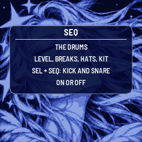

### Degrees

A key changes the scale. SELECT + a key changes something else: whether chords may stand on that note. The note stays
in the scale, so the melody and the chords' other notes can still use it, but no chord is built on it and the bass
doesn't sit on it as a root. The screen says `NO CHORDS ON F#`, or `CHORDS ON F#`, and the change takes effect from
the next chord.

At least two degrees stay on, besides the root: the screen says `2 DEGREES` `AT LEAST` otherwise. A note outside the
scale can't be changed (`NOT IN` `THE SCALE`). The setting is kept relative to the key, so it survives a change of Root,
and it's saved with the piece. A note you take out of the scale keeps its setting for when it comes back.

Hold SELECT alone to see them. While SELECT is held, the keys that chords may not stand on go dark.

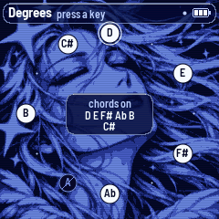

---

## 4. Building a piece

The piece is yours. It powers on in **Hands**, with only the keys and the pad playing. You bring in the rest and
take it away; AQ-1 goes on composing the chords, the rhythms and the melody, and leaves what plays, and when, to you.

Hold SELECT and press a layer's button. It's a real switch: what's off comes on, what's on goes off. Layers work at any
Energy and in every style:

| Hold SELECT, press | Layer | When |
|---|---|---|
| ENV | Keys and pad | Over about a second |
| ARP | Melody | Over about a second, with a phrase within a few bars |
| LFO | Bass | On the next bar line |
| SEQ | Kick and snare, with the ghosts, rim and tom | On the next bar line |
| FX | Hats | On the next bar line |

(While resting there is no bar to wait for: it happens at once.)

A layer that's off only stops being heard. Its level stays where it was, its echoes and reverb ring out, its MIDI goes
on as at level 0, and everything goes on composing unheard, so it comes in at the right place in the song. With the
drums off, the kick no longer pulls the keys down. The screen says `BASS ON` or `BASS OFF`, and so on. A layer that's
off reads empty on its meter, and with Lights on, its button loses its glow unless it's the page you're on.

The layers you have on stay on when you change piece, when a piece goes back to its recipe, and through rests. They
aren't saved: power-on goes back to the keys and the pad.

### Energy

**Energy** (Home, KNOB 2) is how much the drums you have on play, and the character of the harmony. It never turns a
layer on or off, and the whole range is a beat, in every style:

| Energy | Drums | Harmony |
|---|---|---|
| 0–9 | Half time, sparse | Alone |
| 10–34 | Half time | Drifting |
| 35–59 | Light | Grown |
| 60–79 | Full | Grown |
| 80–100 | Full | At its peak |

The higher the Energy, the busier the rhythm within each step too, the heavier the bass and the firmer the piano. The
Style still counts: its rhythm and its bass figures. Drift's full rhythm is still a sparse thing.

### Sections

**EDIT** steps to the next section, on the next bar, and there it stays; in Hands no section comes by itself, however
long you wait. A section doesn't say what plays. It brings a new chord at once, a new groove for the drums at the density
Energy asks, how busy the melody is (the Full section busiest, the Intro and Out sparest), and a step in the harmony's
colour: down in the Intro, the Breakdown and Out, up in Full.

### Breaks

**SELECT + EDIT** calls a break on the next bar, if the drums are on and their level is above 0. In Hands no break comes
any other way, and the **Breaks** knob (Drums, KNOB 2) says how long it is: up to 33 one bar, up to 66 two, above that
four. A break ends with its phrase, so the next phrase lands on the grid.

While a break is heard, the screen shows its frame, with the bars it has. Turning a knob brings the page back for a
moment. Press PLAY in the middle of one and the screen goes to the rest or the page; PLAY again carries the break on
from where it stopped.

---

## 5. Auto

SELECT + HOME switches the piece to **Auto** and back, and the screen says `AUTO` or `HANDS`. The piece keeps its choice
when saved. In Auto the arranger leads the sections by itself, through Intro, Hats, Light, Breakdown, Full and Out, and
all the layers are on: this is the piece playing itself. Auto and Hands each keep their own set of layers, so switching
takes you to that mode's set, and on from the section you were in.

In Auto:

- **Energy** is a ceiling on the sections: under 10 hats at most, under 35 half time at most, under 60 the light beat,
  and from 60 everything. Above 70 the breakdowns get shorter.
- **Breaks** is how often the arranger plays a break, and 0 means none. SELECT + EDIT still calls one, and EDIT still
  moves on to the next section.
- A press on a layer that's playing takes it out, and it stays out whatever section comes.
- A press on a layer the arranger has absent right now brings it: the next bar goes to the first place it plays
  (`DRUMS ON`, and you're in the Light section, say). Under Energy 10 Auto has no drums anywhere to go to, and the
  screen says `DRUMS ON` `ENERGY UP`.

---

## 6. The pieces

PRESETS chooses one of eight pieces. Each is a recipe: key, mode, tempo, style and every knob. Each remembers how you
left it, including its scale, its degrees, its sounds and Hands or Auto. A card shows the piece for a moment. Each new piece, and
each power-on, starts composing from a new seed, so the settings are kept but the music is always new.

Hold SAVE for 1.5 s to put the piece you're on back to its recipe. Tune, MIDI out and Lights are the same for all pieces.
All eight start in Hands, with the first sound of each layer.

| Piece | Key and mode | Tempo | Style | Character |
|---|---|---|---|---|
| **Load Screen** | D Lydian | 170 | Liquid | The wait itself |
| **Aqua** | A Ionian | 172 | Liquid | Sunny, glossy |
| **Skyline** | G Mixolydian | 180 | Roller | Open, the fastest |
| **Rainfall** | C Dorian | 160 | Drift | More room, a sparse beat |
| **Aurora** | E Lydian | 164 | Loading | Wide pads, slow light |
| **Lagoon** | Ab Ionian | 168 | Roller | The warmest, on the bass |
| **Save Point** | Bb pentatonic major | 152 | Drift | The quietest, to rest |
| **Afterglow** | F Aeolian | 166 | Jungle | Sunset, in minor |

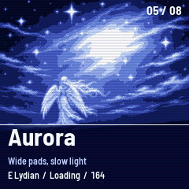

---

## 7. The pages

Seven pages, each on its own button, with four values on KNOB 1–4. SELECT steps through them in this order.

### HOME: Home

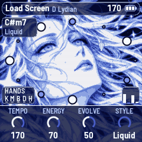

- **Tempo:** 150 to 180 (also hold HOME and turn SELECT, from any page).
- **Energy:** see "Building a piece" and "Auto".
- **Evolve:** repeat or change. At 0 it repeats one phrase; in the middle it repeats and varies; at 100 it never repeats.
- **Style:** the rhythm and the bass figures.
  - **Liquid:** an even two-step with few breaks. The main one.
  - **Roller:** a rolling beat, more ghost notes, a busier bass.
  - **Jungle:** chopped breaks more often, more syncopation.
  - **Half:** half time as its base.
  - **Drift:** hardly any drums, long breakdowns.
  - **Loading:** an endless build that seldom reaches the full beat.

  In Hands, Energy sets the level, so a style is its rhythm's weights and its bass. The long breakdowns and the endless
  build are the arranger's, in Auto.

### ENV: Keys

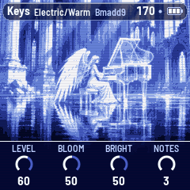

- **Level:** the keys' level. The pad follows it.
- **Bloom:** how slowly a chord opens and closes, from about 15 ms to over a second in its attack.
- **Bright:** from dark to bright.
- **Notes:** how many lone notes a chord may have between changes, 0 to 3. Short chords have fewer.

### ARP: Melody

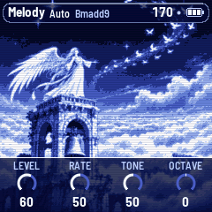

- **Level.**
- **Rate:** how often a phrase comes.
- **Tone:** the voices it chooses from, the softest to the brightest (flute, vocal, vibes, marimba, music box, glass). With a
  sound chosen (see "Sounds"), only how bright that voice is.
- **Octave:** two down to two up (OCT− and OCT+ too).

### LFO: Bass

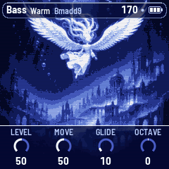

- **Level.**
- **Move:** which figures it may play, from long roots to rolling ones.
- **Glide:** how slowly it slides to its next note, from about 1 ms to 300 ms.
- **Octave:** one down, home, or one up.

### SEQ: Drums

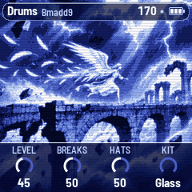

- **Level:** the kick and the snare, with the ghosts, rim and tom.
- **Breaks:** in Hands, how long a called break is; in Auto, how often the arranger plays one.
- **Hats:** their level.
- **Kit:** Glass or Moss.

### FX: Space

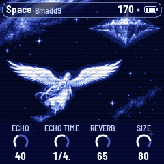

- **Echo:** how much goes to the echoes.
- **Echo time:** 1 bar, 1/2, a dotted half, a dotted quarter, 2 bars or 4 bars.
- **Reverb:** how much goes to the plate.
- **Size:** how long the plate rings and how many times the echo comes back.

### GLO: Setup

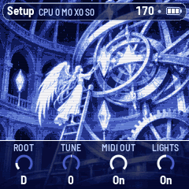

- **Root:** the key's root note. The scale moves with it.
- **Tune:** fine tuning, ±50 cents.
- **MIDI out:** on or off.
- **Lights:** On: the keys light the scale, and the unlit buttons glow dimly so they can be read on the black FM-1.
  Keys: the key lights only. Off.

At the top of this page is a reading of how the FM-1 is coping, `CPU n Mn Xn Sn`:

| | |
|---|---|
| **CPU** | The sound's load right now, % |
| **M** | The heaviest audio block so far, % of the time a block has |
| **X** | Blocks missed |
| **S** | Blocks that ran too long. On a second one soon after the first, AQ-1 sheds voices to catch up |

Press GLO again, on this page, to start M and S afresh.

### Sounds

The keys, the pad, the bass and the melody each have a choice of sound, kept with the piece. The four knobs stay what they are: hold SELECT and turn KNOB 1 on the
layer's page, one sound a click, round and round (on the Keys page, KNOB 2 for the pad). The top line says it for a moment (`BASS SOUND` `Hollow`) and then keeps it next to the page's name.
The other knobs, and the knobs on the other pages, do what they always do with SELECT held.

| Layer | Sound | What it is |
|---|---|---|
| Keys | **Electric** | The electric piano: a soft tine, and a body that opens after the attack |
| | **Clear** | Clean and glassy: no tine, the octaves above the note, and it stays open |
| | **Organ** | Soft and hollow, like a stopped pipe: only the odd harmonics, steady |
| | **Felt** | Warm and dark: nearly the pure note, the filter closed further |
| Pad | **Warm** | Two saws a few cents apart under a dark filter |
| | **Airy** | The filter wide open, more of it in the room, a little wider apart |
| | **Choral** | Further apart and equal, so it moves like voices together |
| | **Deep** | Close together, the filter low, only the body of the chord |
| Bass | **Warm** | A round sub that speaks a little as each note starts |
| | **Sub** | The pure sine, deep, with nothing over it |
| | **Hollow** | The odd harmonics: it carries more on small speakers |
| | **Round** | More of the octave above, a softer start and end |
| Melody | **Auto** | AQ-1 chooses from what Tone allows, and changes it now and then |
| | **Flute**, **Vocal**, **Vibes**, **Marimba**, **Music box**, **Glass** | Always that voice. The phrases are the same ones either way |

**When you hear it:**

- **Keys:** the bus and the chord sounding change within about a second, and the whole sound comes with the next chord.
- **Pad:** the sounding chord moves to it over about 150 ms.
- **Bass:** on the note sounding, in about a tenth of a second. Resting, the bass isn't playing: you hear it when it plays again.
- **Melody:** from its next note. If no phrase is under way, one quiet note in the new voice answers the turn, once you stop turning.

The sound doesn't change what's composed, and MIDI out is the same whichever you choose. All of them work in Hands and in Auto, and none costs noticeably more to play.

---

## 8. The screens

The screen shows one of these, the first that applies, in this order: a help card; Degrees; the title at power-on; the
save; a piece's card; a break; a page; then the rest, the hold or Home.

**Top line:** on Home, the piece with its root and mode; on a page, the page's name, its sound (Keys: the keys' sound and the pad's, `Felt/Warm`) and the chord (Setup: its reading
instead; if there is no room, the chord gives way). On the right, the tempo (EXT when it follows MIDI clock, with a mark while resting), a dot when there are
unsaved changes, and the battery. Messages (`ADDED F#`, `BREAK ON THE BAR`) show here for a moment.

**The battery:** three bars when it's full, fewer as it runs down, with a warning colour at one bar or none. On USB power
it shows a lightning bolt.

**Bottom:** on Home, the pages and the hold, the four values, one for each knob. The one you're turning lights up.

### Home

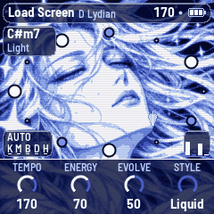

- **The face:** the eyes are closed with no drums and half open with drums. They're open on a full beat, and for 8 s after
  a new section. They blink now and then on a bar line. It smiles when a layer comes in and when SAVE saves.
- **The ring:** the twelve notes, with the root at the top, ringed. A small dot is a note out of the scale, a soft bead a
  note in it, a bright one a note of the chord, and a hollow one a note chords may not stand on.
- **Top left:** the chord's name. Under it, the section in Auto and the style in Hands.
- **Bottom left:** `HANDS` or `AUTO`, and the five layers: **K**eys, **M**elody, **B**ass, **D**rums, **H**ats. A letter is
  marked when its layer is playing and dimmed when it's off.
- **Bottom right:** four meters: keys, melody, bass, drums.
- A feather falls on a new chord, and now and then a star shows in the hair.

### Pages

Each page has its own picture behind the knobs, and the same top line.

### Break


Only over a break you can hear: not at rest, not with the drums off, not at Drums level 0.

### Title, card and save

The title shows at power-on for about 2.6 s, or until you touch something. A piece's card shows for about 2.6 s. SAVE has its own short
animation; an autosave shows nothing.

### Rest and hold

 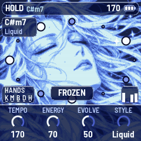

Resting on Home, the face dims and the screen says `REST`, `PLAY TO WAKE`, with no top line; turning a knob shows the four values for a
moment. Holding the chord on Home, the face goes to ice and the top line says `HOLD`; on
a page, the chord in the top line goes to ice.

---

## 9. The system's notes

AQ-1 has one small voice of its own, taken from the chord playing:

- **Power-on:** five notes going up. It doesn't sing when it comes back from a cancelled update.
- **A page's button, a new piece:** one quiet blip.
- **SAVE:** three notes going up, once the sound has come back. An autosave has none.

They don't go out over MIDI.

---

## 10. MIDI

MIDI comes in over USB and the TRS jack, and goes out over USB.

- **In, channel 1:** a note adds or removes its note from the scale, like a key.
- **In, clock:** the beat follows MIDI clock, and start, stop and continue move the grid. The screen shows EXT for the tempo.
- **Out** (on by default):

  | Channel | Layer | Notes |
  |---|---|---|
  | 1 | Keys | |
  | 2 | Melody | |
  | 3 | Bass | |
  | 4 | Pad | No glides |
  | 10 | Drums | Kick 36, snare 38, ghosts and soft snares 38 lower, rim 37, tom 45, closed hat 42, open hat 46 |

  It also sends clock, with start and stop, when it runs on its own tempo.

**Off layers still send.** A layer that's switched off, or turned down to level 0, goes silent inside the FM-1 but keeps
sending its MIDI, so you can play it from another instrument. Turning MIDI out off lets every note go and sends all notes off.

### Screen reader

AQ-1 can tell a screen reader what its screen shows. Connect the FM-1 by USB, open the
[FM-1 Screen Reader](https://charlesvestal.github.io/fm1-reader/) in Chrome or Edge, and click Connect. It reads out the page
you're on and its knobs, a knob's value as you turn it, the piece and its key, the notes you add or take out, help cards,
every message, the layers and the mode, a break, and the chord each time it moves. Press W to hear the whole screen again.
The FM-1 says nothing until the page connects, so a DAW on the same cable never sees it.

---

## 11. Saving

AQ-1 keeps all eight pieces in the FM-1's memory, each as you left it: the knobs, the scale, the degrees, the sounds, Hands or Auto,
and the piece you're on, plus Tune, MIDI out and Lights. The music isn't saved, and neither are the layers you switched:
power-on starts anew, with the keys and the pad.

Writing to the memory stops everything for a moment, so every write goes through a dip in the volume: down in 150 ms, the
write, and back in 300 ms.

- **By itself (autosave):** 4 seconds after the last touch, but only while resting. A touch or MIDI start before the
  write cancels it. It never saves while playing. A dot at the top of the screen means there are unsaved changes.
- **SAVE:** saves now, playing or not, with its animation and its three notes. Buttons pressed during a save wait and
  then act, in order. Knobs, keys and PLAY don't wait.
- **Hold SAVE** for 1.5 s: the piece goes back to its recipe. That isn't saved until the next save, so switching off
  before then brings your version back.
- If a write fails, the screen says `NOT SAVED` `FLASH ERROR`, and it doesn't try by itself again until something changes.

A save from another firmware, or from another version of AQ-1's format, isn't read: the pieces start from their recipes.

---

## 12. Troubleshooting

**Update mode:** hold OCT− and OCT+ together for five seconds. A countdown appears; let go before it ends to cancel. A
cancelled update plays again, and your unsaved changes stay marked as unsaved.

**Calibration:** if a button or knob does the wrong thing, hold OCT− and OCT+ while you switch the FM-1 on. The screen then
asks you to press each button and turn each knob in turn.

**After a crash:** AQ-1 shows a red CRASH screen and restarts by itself a few seconds later. The next start shows
RESTARTED AFTER A CRASH and an address (PC ...) for a moment. If you report the problem, include that address and what you
were doing.

**Safe mode:** if AQ-1 crashes twice in a row while starting, it starts in SAFE MODE instead. There's no sound, but USB
works, so the installer can reach it: install AQ-1 again, or put the stock firmware back. Press PLAY to try starting AQ-1
normally again. If even safe mode fails twice, the FM-1 drops into the chip's own update mode, and only the rescue below can
reach it.

### Recovering an FM-1 that won't start

An FM-1 in the chip's own update mode shows a blank screen, and neither the installer nor M-VAVE's updater can see it. A
script can put M-VAVE's firmware back, on a Mac, with the USB cable you already have.

Open Terminal, paste this line and press Return:

```
bash -c "$(curl -fsSL https://raw.githubusercontent.com/hugelton/felucca-bsp/main/tools/fm1_rescue.sh)"
```

1. If a window asks to install the command line developer tools, click Install. When it has finished, paste the line again.
2. If it asks for a password, type your Mac password (nothing shows as you type) and press Return.
3. When it says it's waiting, plug the FM-1 in and switch it on. The script catches it, checks the chip, saves a backup of
   the FM-1's memory in the `fm1-rescue` folder in your home folder, and asks before it writes anything.
4. Type **yes** and press Return. Don't unplug anything until it says it's restarting the FM-1. The FM-1 then starts into its
   original firmware, and you can install AQ-1 again from there.

The script downloads M-VAVE's FM-1 V15 firmware and JieLi's flash loader, and checks both against known fingerprints. It
writes only the firmware area of the memory, never the bootloader or the FM-1's own settings, and checks everything it
writes. Running it again is always safe. If the FM-1 never shows up at all, Felucca's
[FM-1-transporter](https://github.com/kurogedelic/FM-1-transporter) (a small RP2040 board wired to the USB lines) can still
reach it.

---

## 13. Parameters

The defaults are Load Screen's; each piece has its own.

| Page | Value | Range | Load Screen |
|---|---|---|---|
| Home | Tempo | 150–180 | 170 |
| Home | Energy | 0–100 | 70 |
| Home | Evolve | 0–100 | 50 |
| Home | Style | Liquid, Roller, Jungle, Half, Drift, Loading | Liquid |
| Keys | Level | 0–100 | 60 |
| Keys | Bloom | 0–100 | 50 |
| Keys | Bright | 0–100 | 50 |
| Keys | Notes | 0–3 | 3 |
| Melody | Level | 0–100 | 60 |
| Melody | Rate | 0–100 | 50 |
| Melody | Tone | 0–100 | 50 |
| Melody | Octave | −2 – +2 | 0 |
| Bass | Level | 0–100 | 50 |
| Bass | Move | 0–100 | 50 |
| Bass | Glide | 0–100 | 10 |
| Bass | Octave | −1 – +1 | 0 |
| Drums | Level | 0–100 | 45 |
| Drums | Breaks | 0–100 | 50 |
| Drums | Hats | 0–100 | 50 |
| Drums | Kit | Glass, Moss | Glass |
| Space | Echo | 0–100 | 40 |
| Space | Echo time | 1 bar, 1/2, 1/2., 1/4., 2 bars, 4 bars | 1/4. |
| Space | Reverb | 0–100 | 65 |
| Space | Size | 0–100 | 80 |
| Setup | Root | C – B | D |
| Setup | Tune | −50 – +50 cents | 0 |
| Setup | MIDI out | Off, On | On |
| Setup | Lights | Off, On, Keys | On |
| ALGORITHM | Mode | 8 modes, or Custom | Lydian |
| Keys, SELECT + KNOB 1 | Keys' sound | Electric, Clear, Organ, Felt | Electric |
| Keys, SELECT + KNOB 2 | Pad's sound | Warm, Airy, Choral, Deep | Warm |
| Melody, SELECT + KNOB 1 | Melody's sound | Auto, Flute, Vocal, Vibes, Marimba, Music box, Glass | Auto |
| Bass, SELECT + KNOB 1 | Bass's sound | Warm, Sub, Hollow, Round | Warm |

---

## 14. Credits

AQ-1's code is free software under the Mozilla Public License 2.0. The licence of the screen's art has not been decided and
the MPL doesn't cover it; see `LICENSING.md`.

- AQ-1 is a fork of [AMB-1](https://github.com/charlesvestal/fm1-amb) by Charles Vestal. This manual grew from AMB-1's, and
  the echoes come from AMB-1, which took them from the chain of Brian Eno's *Discreet Music*.
- The reverb is Jon Dattorro's plate ("Effect Design, Part 1", JAES 1997), by way of
  [FoMni-1](https://charlesvestal.github.io/fm1-fomni/).
- The platform (hardware layer, USB, update loader, installer and storage) is
  [fm1-base](https://github.com/charlesvestal/fm1-base) and [felucca-bsp](https://github.com/hugelton/felucca-bsp), from
  **Felucca** by Leo Kuroshita, Hügelton Instruments.
- The idea of running FM-1 firmware in the browser comes from [Groove OS](https://www.groove-os.com/).
- The fonts are Barlow Semi Condensed and Terminus (SIL Open Font License).

M-VAVE and FM-1 are trademarks of their owners. AQ-1 is not connected with M-VAVE, Charles Vestal, Brian Eno or Hügelton
Instruments.
